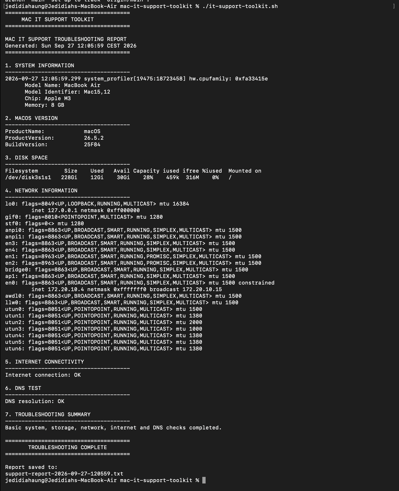

# Mac IT Support Troubleshooting Toolkit

A beginner-friendly Bash script for performing common first-line IT support diagnostics on macOS.

## Project Overview

This project was created as a practical IT support portfolio project.

The toolkit automates several basic troubleshooting checks that an IT support technician may perform when investigating a user's Mac.

## Demo

Example output from the troubleshooting toolkit:



## Features

- System hardware information
- macOS version detection
- Disk space check
- Network configuration information
- Internet connectivity test
- DNS connectivity test
- Automatic troubleshooting report generation

## Technologies Used

- Bash
- macOS Terminal
- Git
- GitHub

## How to Use

Clone the repository:

```bash
git clone https://github.com/yeddaung16-ui/mac-it-support-toolkit.git

